# MÔ TẢ ĐẦY ĐỦ DỰ ÁN — QUẢN LÝ ĐỀ THI TRẮC NGHIỆM (EXAM BANK)

> **Mục đích tài liệu:** File này là tài liệu tham chiếu DUY NHẤT và ĐẦY ĐỦ cho toàn bộ dự án đồ án môn Công nghệ XML (**Phiên bản 2.2 — cập nhật 20/11/2026**). Bất kỳ AI hoặc thành viên mới nào đọc file này đều có thể hiểu bối cảnh, nghiệp vụ, thực thể, chức năng, ràng buộc kỹ thuật, workflow, cấu trúc XML/XSD/XSLT mẫu và yêu cầu đầu ra — không cần đọc thêm tài liệu nào khác.

> **QUYẾT ĐỊNH THIẾT KẾ ĐÃ CHỐT (v2.2 — 20/11/2026):**
> * Chi tiết đề thi được lưu **NESTED** trong `DeThi.xml`: thẻ `<CacCauHoi>` chứa nhiều `<MaCauHoi>`. **Thứ tự xuất hiện của `<MaCauHoi>` chính là `ThuTu` (1..n).**
> * **Không có** `ChiTietDeThi.xml` và `ChiTietDeThi.xsd` trong dự án.
> * Entity `ChiTietDeThi` (Phần 3.5) **vẫn giữ** ở mức mô hình logic để vẽ ERD — XML nested là cách hiện thực hóa mô hình đó.
> * Lý do: tận dụng thế mạnh lồng nhau của XML, giảm số file, đơn giản hóa code đọc/ghi.
> * Công nghệ thao tác XML chính: **LINQ to XML (`XDocument`)**, kết hợp **XPath** (`System.Xml.XPath`) cho các truy vấn theo cấu trúc.

> **LỊCH SỬ THAY ĐỔI SO VỚI v2.1:**
> 1. Đổi thẻ `<DanhSachCauHoi>` bên trong `DeThi.xml` thành `<CacCauHoi>` (tránh trùng tên với thẻ gốc của `CauHoi.xml`, dễ nhầm khi viết LINQ/XPath).
> 2. Bổ sung ràng buộc `xs:key` / `xs:unique` vào XSD để ép "PK không trùng" bằng lược đồ (trước đây chỉ ghi trong bảng mô tả).
> 3. Mật khẩu lưu dạng **SHA-256** (64 ký tự hex) thay vì plain text; XSD kiểm tra đúng định dạng này.
> 4. Thêm file XSLT mẫu (6.9) dùng `document()` + `xsl:key` để lấy nội dung câu hỏi và tên môn từ `CauHoi.xml`, `MonHoc.xml` (vì `DeThi.xml` chỉ chứa mã).
> 5. Bổ sung ma trận phân quyền, quy tắc toàn vẹn khi xóa/sửa, quy tắc FK chéo (câu hỏi trong đề phải cùng môn với đề).
> 6. Đồng bộ với `TaskAssignment.md`: nhóm **3 người** (Tài, Thiết, Vinh), cấu trúc thư mục, mốc viết báo cáo theo tuần.
> 7. Xóa các mục 6.5 / 6.10 (phương án tách file `ChiTietDeThi`) vì đã chốt không dùng; đánh số lại Phần 6.

---

## PHẦN 1: THÔNG TIN CHUNG

| Mục | Nội dung |
| :--- | :--- |
| **Tên đề tài** | Quản lý đề thi trắc nghiệm (Exam Bank) |
| **Môn học** | Công nghệ XML |
| **Nền tảng** | WinForms (C# / .NET Framework 4.8) |
| **IDE** | Visual Studio 2019 hoặc 2022 |
| **Cơ sở dữ liệu** | File XML (`.xml`) + Lược đồ XSD (`.xsd`) |
| **Công nghệ bắt buộc** | XML, XSD, XSLT, WinForms, LINQ to XML (`XDocument`) |
| **Công nghệ sử dụng thêm** | XPath (`System.Xml.XPath`), băm mật khẩu SHA-256, phân quyền, tách lớp DAL/UI |
| **Công nghệ tùy chọn** | Xuất PDF (iTextSharp/PdfSharp), Guna UI/Bunifu |
| **Mức độ đề tài** | Khá – Khó |
| **Số thành viên** | 3 người: **Tài, Thiết, Vinh** (chi tiết ở Phần 10 và `TaskAssignment.md`) |

---

## PHẦN 2: BỐI CẢNH NGHIỆP VỤ

### 2.1. Hiện trạng
Giáo viên quản lý câu hỏi trắc nghiệm và tạo đề thi thủ công bằng Word hoặc Excel. Việc này gây khó khăn khi:
* Ngân hàng câu hỏi lớn, khó tìm kiếm theo môn học/độ khó.
* Tạo đề thi mất thời gian (trung bình 45–90 phút cho đề 40 câu), dễ trùng câu hỏi.
* Không có công cụ kiểm tra tính hợp lệ của đề thi (ví dụ: thiếu đáp án, sai định dạng).
* Không thể tái sử dụng câu hỏi cho nhiều đề thi khác nhau.
* Không có thống kê nhanh số lượng câu hỏi theo môn/độ khó.

### 2.2. Mục tiêu phần mềm
Xây dựng ứng dụng cho phép:
* Quản lý ngân hàng câu hỏi trắc nghiệm (thêm/sửa/xóa/tìm kiếm).
* Tạo đề thi tự động từ ngân hàng câu hỏi theo tiêu chí (môn học, độ khó, số lượng).
* Hiển thị đề thi ra trình duyệt (thông qua XSLT) để xem trước hoặc in.
* Kiểm tra tính hợp lệ của dữ liệu XML (dựa trên XSD) và tính toàn vẹn tham chiếu giữa các file.
* Phân quyền người dùng (Admin / Giáo viên).
* Thống kê nhanh số câu hỏi, số đề theo môn / độ khó.

### 2.3. Đối tượng sử dụng và ma trận phân quyền

| Đối tượng | Vai trò |
| :--- | :--- |
| **Admin** | Quản lý toàn bộ hệ thống: câu hỏi, đề thi, môn học, người dùng |
| **Giáo viên** | Thêm/sửa câu hỏi và môn học, tạo đề, xem/xuất đề, đổi mật khẩu của chính mình. **Không được xóa bất kỳ dữ liệu nào** |

| Thao tác | Admin | Giáo viên |
| :--- | :---: | :---: |
| Đăng nhập, đổi mật khẩu của mình | ✅ | ✅ |
| Xem / tìm kiếm môn học, câu hỏi | ✅ | ✅ |
| Thêm / sửa môn học | ✅ | ✅ |
| Thêm / sửa câu hỏi | ✅ | ✅ |
| Tạo đề, xem đề, xuất HTML/PDF | ✅ | ✅ |
| Xem thống kê | ✅ | ✅ |
| **Xóa** môn học / câu hỏi / đề thi | ✅ | ❌ |
| Quản lý người dùng (thêm/sửa/xóa) | ✅ | ❌ |

### 2.4. Quy trình nghiệp vụ (sau khi có phần mềm)
1. **Admin** đăng nhập $\rightarrow$ tạo môn học mới (nếu cần) $\rightarrow$ tạo tài khoản giáo viên.
2. **Giáo viên** đăng nhập $\rightarrow$ thêm câu hỏi vào ngân hàng (chọn môn, độ khó, nhập 4 đáp án + đáp án đúng).
3. **Khi cần ra đề:** Giáo viên mở form *"Tạo đề thi"* $\rightarrow$ chọn môn, chọn số câu mỗi độ khó $\rightarrow$ nhấn *"Tạo"* $\rightarrow$ hệ thống bốc câu hỏi ngẫu nhiên, lưu vào `DeThi.xml` (kèm `NguoiTao` và danh sách câu hỏi).
4. Giáo viên xem trước đề qua `WebBrowser` (XSLT render) hoặc xuất HTML/PDF để in.
5. **Khi cần sửa/xóa đề:** Mở form xem đề $\rightarrow$ chọn đề $\rightarrow$ (Admin) xóa đề.

> **Lưu ý về tài khoản người dùng:** Dữ liệu và hàm `NguoiDungDAL` (thêm/sửa/xóa) là bắt buộc. Form giao diện *"Quản lý người dùng"* là **tùy chọn** (làm nếu còn thời gian, xem `TaskAssignment.md` T-C07); nếu chưa có form, Admin thêm tài khoản bằng cách chỉnh `NguoiDung.xml` với mật khẩu đã băm SHA-256.

### 2.5. Phạm vi
* **Trong phạm vi:** Quản lý môn học, câu hỏi, đề thi, người dùng; hiển thị đề thi qua XSLT; kiểm tra XSD + FK; tạo đề tự động; thống kê.
* **Ngoài phạm vi:** Chấm điểm tự động, quản lý lớp học, quản lý học sinh làm bài, thống kê kết quả thi (có thể phát triển ở đồ án sau).

---

## PHẦN 3: CÁC THỰC THỂ VÀ THUỘC TÍNH

### 3.1. Câu hỏi (`CauHoi`)

| Thuộc tính | Kiểu dữ liệu | Ràng buộc | Mô tả |
| :--- | :--- | :--- | :--- |
| `MaCauHoi` | `string` | PK, không trùng (`xs:key`), pattern `CH\d{3}` | Mã câu hỏi (VD: `CH001`) |
| `NoiDung` | `string` | Bắt buộc, 1–500 ký tự | Nội dung câu hỏi |
| `DapAnA` | `string` | Bắt buộc, 1–255 ký tự | Đáp án A |
| `DapAnB` | `string` | Bắt buộc, 1–255 ký tự | Đáp án B |
| `DapAnC` | `string` | Bắt buộc, 1–255 ký tự | Đáp án C |
| `DapAnD` | `string` | Bắt buộc, 1–255 ký tự | Đáp án D |
| `DapAnDung` | `string` | Chỉ nhận `A`/`B`/`C`/`D` | Đáp án đúng |
| `DoKho` | `int` | Chỉ nhận `1`, `2`, `3` | Độ khó (1: Dễ, 2: Trung bình, 3: Khó) |
| `MaMonHoc` | `string` | FK $\rightarrow$ `MonHoc`, pattern `MH\d{3}` | Môn học của câu hỏi |

### 3.2. Môn học (`MonHoc`)

| Thuộc tính | Kiểu dữ liệu | Ràng buộc | Mô tả |
| :--- | :--- | :--- | :--- |
| `MaMonHoc` | `string` | PK, không trùng (`xs:key`), pattern `MH\d{3}` | Mã môn học (VD: `MH001`) |
| `TenMonHoc` | `string` | Bắt buộc, 1–100 ký tự | Tên môn học (VD: Lập trình C#) |
| `MoTa` | `string` | Không bắt buộc, $\le$ 255 ký tự | Mô tả thêm |

### 3.3. Đề thi (`DeThi`)

| Thuộc tính | Kiểu dữ liệu | Ràng buộc | Mô tả |
| :--- | :--- | :--- | :--- |
| `MaDeThi` | `string` | PK, không trùng (`xs:key`), pattern `DT\d{3}` | Mã đề thi (VD: `DT001`) |
| `TenDeThi` | `string` | Bắt buộc, 1–200 ký tự | Tên đề thi |
| `MaMonHoc` | `string` | FK $\rightarrow$ `MonHoc`, pattern `MH\d{3}` | Môn học của đề thi |
| `NguoiTao` | `string` | FK $\rightarrow$ `NguoiDung.TenDangNhap` | Người tạo đề (audit) |
| `ThoiGianLamBai` | `int` | 1–600 (phút) | Thời gian làm bài (phút) |
| `NgayTao` | `date` | Bắt buộc, định dạng `yyyy-MM-dd` | Ngày tạo đề |
| `CacCauHoi` | `list` | Ít nhất 1 câu, **không trùng câu trong cùng đề** (`xs:unique`) | Danh sách mã câu hỏi trong đề; vị trí trong danh sách = `ThuTu` (xem 3.5) |

### 3.4. Người dùng (`NguoiDung`)

| Thuộc tính | Kiểu dữ liệu | Ràng buộc | Mô tả |
| :--- | :--- | :--- | :--- |
| `TenDangNhap` | `string` | PK, không trùng (`xs:key`), `[A-Za-z0-9_]{3,50}` | Tên đăng nhập |
| `MatKhau` | `string` | Bắt buộc, đúng 64 ký tự hex `[0-9a-f]{64}` | **Mã băm SHA-256** của mật khẩu (không lưu mật khẩu gốc) |
| `HoTen` | `string` | Bắt buộc, 1–100 ký tự | Họ tên người dùng |
| `Quyen` | `string` | Chỉ nhận `Admin`/`GiaoVien` | Quyền hạn |

### 3.5. Chi tiết đề thi (`ChiTietDeThi`) — chỉ ở mức mô hình logic
> **Mục đích:** Chuẩn hóa quan hệ nhiều-nhiều giữa `DeThi` và `CauHoi` để vẽ ERD. **Trong XML, thực thể này được lưu nested** bên trong `DeThi.xml` (thẻ `<CacCauHoi>`), không có file riêng.

| Thuộc tính | Kiểu dữ liệu | Ràng buộc | Cách thể hiện trong XML nested |
| :--- | :--- | :--- | :--- |
| `MaDeThi` | `string` | PK, FK $\rightarrow$ `DeThi` | Phần tử cha `<DeThi>` bao quanh |
| `MaCauHoi` | `string` | PK, FK $\rightarrow$ `CauHoi` | Giá trị của thẻ `<MaCauHoi>` |
| `ThuTu` | `int` | > 0, không trùng trong cùng đề | Vị trí xuất hiện của `<MaCauHoi>` (thẻ đầu tiên = 1) |

* **Khóa chính:** Tổ hợp `(MaDeThi, MaCauHoi)` — được đảm bảo bằng `xs:unique` (không lặp câu trong đề) kết hợp `xs:key` trên `MaDeThi`.

---

## PHẦN 4: MỐI QUAN HỆ GIỮA CÁC THỰC THỂ (ERD LOGIC)

### 4.1. Sơ đồ quan hệ

```text
MonHoc (1) ----< (N) CauHoi
MonHoc (1) ----< (N) DeThi
DeThi (1) ----< (N) ChiTietDeThi >---- (1) CauHoi
NguoiDung (1) ----< (N) DeThi   [qua NguoiTao]
```

**Giải thích:**
* Một Môn học có nhiều Câu hỏi.
* Một Môn học có nhiều Đề thi.
* Một Đề thi chứa nhiều Câu hỏi — thể hiện qua thực thể trung gian `ChiTietDeThi` (quan hệ $N-N$ giữa `DeThi` và `CauHoi`, có `ThuTu` để giữ thứ tự câu trong đề).
* Một Người dùng (Giáo viên/Admin) có thể tạo nhiều Đề thi — thể hiện qua `DeThi.NguoiTao` (FK $\rightarrow$ `NguoiDung.TenDangNhap`).
* Người dùng còn dùng để đăng nhập và phân quyền.

> **Cách hiện thực hóa bằng XML (đã chốt):** `DeThi.xml` chứa luôn danh sách câu hỏi bên trong thẻ `<CacCauHoi>`. Khi trình bày báo cáo, giải thích: *ERD có bảng `ChiTietDeThi`; trong XML, bảng này "nhúng" vào `DeThi` vì XML hỗ trợ cấu trúc cây; `ThuTu` được biểu diễn bằng thứ tự xuất hiện của phần tử.*

### 4.2. Code DBML cho dbdiagram.io
Truy cập [dbdiagram.io/d](https://dbdiagram.io/d) $\rightarrow$ dán code sau để render ERD trực quan:

```dbml
// =====================================================
// ERD - QUẢN LÝ ĐỀ THI TRẮC NGHIỆM (EXAM BANK)
// Môn: Công nghệ XML
// Công cụ: dbdiagram.io (DBML)
// =====================================================

Table MonHoc {
  MaMonHoc    varchar(10)   [pk, note: 'Mã môn học (VD: MH001)']
  TenMonHoc   nvarchar(100) [not null, note: 'Tên môn học']
  MoTa        nvarchar(255) [note: 'Mô tả thêm']
}

Table CauHoi {
  MaCauHoi    varchar(10)   [pk, note: 'Mã câu hỏi (VD: CH001)']
  NoiDung     nvarchar(500) [not null, note: 'Nội dung câu hỏi']
  DapAnA      nvarchar(255) [not null]
  DapAnB      nvarchar(255) [not null]
  DapAnC      nvarchar(255) [not null]
  DapAnD      nvarchar(255) [not null]
  DapAnDung   char(1)       [not null, note: 'A/B/C/D']
  DoKho       int           [not null, note: '1: Dễ, 2: TB, 3: Khó']
  MaMonHoc    varchar(10)   [not null, ref: > MonHoc.MaMonHoc]
}

Table NguoiDung {
  TenDangNhap varchar(50)   [pk, note: 'Tên đăng nhập']
  MatKhau     char(64)      [not null, note: 'SHA-256 dạng hex (64 ký tự)']
  HoTen       nvarchar(100) [not null]
  Quyen       varchar(20)   [not null, note: 'Admin / GiaoVien']
}

Table DeThi {
  MaDeThi        varchar(10)   [pk, note: 'Mã đề thi (VD: DT001)']
  TenDeThi       nvarchar(200) [not null]
  MaMonHoc       varchar(10)   [not null, ref: > MonHoc.MaMonHoc]
  NguoiTao       varchar(50)   [not null, ref: > NguoiDung.TenDangNhap, note: 'Người tạo đề']
  ThoiGianLamBai int           [not null, note: 'Phút, 1..600']
  NgayTao        date          [not null]
}

Table ChiTietDeThi {
  MaDeThi  varchar(10) [ref: > DeThi.MaDeThi]
  MaCauHoi varchar(10) [ref: > CauHoi.MaCauHoi]
  ThuTu    int         [not null, note: 'Thứ tự câu trong đề (1..n) - trong XML là vị trí của MaCauHoi']

  indexes {
    (MaDeThi, MaCauHoi) [pk]
  }
}
```

---

## PHẦN 5: CHỨC NĂNG

### 5.1. Mô hình phân cấp chức năng
Render code Mermaid dưới đây tại [mermaid.live](https://mermaid.live) hoặc draw.io (chọn Mermaid):

```mermaid
graph TD
    ROOT["QUẢN LÝ ĐỀ THI TRẮC NGHIỆM<br/>(Exam Bank)"]

    ROOT --> HE["Hệ thống"]
    ROOT --> MH["Quản lý môn học"]
    ROOT --> CH["Quản lý câu hỏi"]
    ROOT --> DT["Quản lý đề thi"]
    ROOT --> XEM["Xem / Xuất đề"]
    ROOT --> TK["Thống kê"]

    HE --> HE1["Đăng nhập / Đăng xuất"]
    HE --> HE2["Phân quyền<br/>(Admin / Giáo viên)"]
    HE --> HE3["Đổi mật khẩu"]
    HE --> HE4["Kiểm tra hợp lệ<br/>(XSD + khóa ngoại)"]

    MH --> MH1["Thêm môn học"]
    MH --> MH2["Sửa môn học"]
    MH --> MH3["Xóa môn học (Admin)"]

    CH --> CH1["Thêm câu hỏi"]
    CH --> CH2["Sửa câu hỏi"]
    CH --> CH3["Xóa câu hỏi (Admin)"]
    CH --> CH4["Tìm kiếm / lọc câu hỏi"]

    DT --> DT1["Tạo đề tự động"]
    DT --> DT2["Xóa đề thi (Admin)"]

    XEM --> XEM1["Xem trước qua<br/>WebBrowser (XSLT)"]
    XEM --> XEM2["Xem bản in"]
    XEM --> XEM3["Xuất HTML độc lập"]
    XEM --> XEM4["Xuất PDF"]

    TK --> TK1["Số câu theo môn / độ khó"]
    TK --> TK2["Số đề theo môn"]

    style ROOT fill:#2c3e50,color:#fff,stroke:#000
    style HE fill:#3498db,color:#fff
    style MH fill:#3498db,color:#fff
    style CH fill:#3498db,color:#fff
    style DT fill:#3498db,color:#fff
    style XEM fill:#3498db,color:#fff
    style TK fill:#3498db,color:#fff
```



### 5.2. Chức năng bắt buộc (Core)

| STT | Chức năng | Mô tả | Công nghệ liên quan |
| :---: | :--- | :--- | :--- |
| 1 | **Đăng nhập** | Đọc tài khoản từ `NguoiDung.xml`, so khớp mã băm SHA-256 của mật khẩu, lưu `Session.CurrentUser` | LINQ to XML, SHA-256 |
| 2 | **Quản lý câu hỏi (CRUD)** | Thêm/sửa/xóa câu hỏi, ghi vào `CauHoi.xml` | LINQ to XML, XPath |
| 3 | **Quản lý môn học (CRUD)** | Thêm/sửa/xóa môn học, ghi vào `MonHoc.xml` | LINQ to XML |
| 4 | **Tạo đề thi** | Chọn môn, chọn số câu theo độ khó $\rightarrow$ tự động bốc câu hỏi, ghi vào `DeThi.xml` (kèm `NguoiTao` = user đang đăng nhập và danh sách câu hỏi nested trong `<CacCauHoi>`) | LINQ to XML |
| 5 | **Xem đề thi** | Hiển thị đề thi qua `WebBrowser` (XSLT biến đổi XML $\rightarrow$ HTML, tự lấy nội dung câu hỏi qua `document()`) | XSLT + `XslCompiledTransform` |
| 6 | **Kiểm tra hợp lệ** | Validate file XML bằng XSD trước khi load/ghi; kiểm tra khóa ngoại giữa các file bằng code | XSD + `XmlReaderSettings` |

### 5.3. Chức năng bổ sung

| STT | Chức năng | Mô tả | Công nghệ liên quan |
| :---: | :--- | :--- | :--- |
| 7 | **Tìm kiếm / lọc câu hỏi** | Lọc theo môn + độ khó bằng XPath; tìm từ khóa trong nội dung | XPath + LINQ |
| 8 | **Xuất đề thi ra HTML** | Lưu file `.html` độc lập bằng `SaveFileDialog` | XSLT |
| 9 | **Phân quyền** | Theo ma trận ở mục 2.3 | Logic C# |
| 10 | **Thống kê** | Số câu theo môn/độ khó, số đề theo môn, tổng số | LINQ `GroupBy` |
| 11 | **Đổi mật khẩu** | Xác minh mật khẩu cũ, lưu mã băm mới | SHA-256 |
| 12 | **Xuất đề thi ra PDF** *(tùy chọn)* | Có/không đáp án | iTextSharp/PdfSharp |
| 13 | **Audit log** *(tùy chọn)* | Ghi `Log.xml` mọi thao tác thêm/sửa/xóa | LINQ to XML |
| 14 | **Backup tự động** *(tùy chọn)* | Sao lưu file XML trước khi ghi, giữ 20 bản gần nhất | `System.IO` |
| 15 | **Form quản lý người dùng** *(tùy chọn)* | Admin thêm/sửa/xóa tài khoản trên giao diện | WinForms |

---

## PHẦN 6: CẤU TRÚC FILE XML MẪU, LƯỢC ĐỒ XSD VÀ XSLT

> **Quy ước:** 6.1–6.4 là XML mẫu; 6.5–6.8 là XSD tương ứng; 6.9 là XSLT mẫu; 6.10 là quy tắc ràng buộc ngoài XSD. Toàn bộ code mẫu trong mục này đã được chạy thử: 4 file XML validate đạt với 4 file XSD, các trường hợp sai (trùng mã, `DoKho = 4`, mật khẩu chưa băm, câu lặp trong đề) đều bị từ chối, và XSLT render đúng. Dự án **không** có `ChiTietDeThi.xml/.xsd`.

### 6.1. `CauHoi.xml`

```xml
<?xml version="1.0" encoding="utf-8"?>
<DanhSachCauHoi>
  <CauHoi>
    <MaCauHoi>CH001</MaCauHoi>
    <NoiDung>Thẻ nào dùng để tạo liên kết trong HTML?</NoiDung>
    <DapAnA>&lt;a&gt;</DapAnA>
    <DapAnB>&lt;link&gt;</DapAnB>
    <DapAnC>&lt;href&gt;</DapAnC>
    <DapAnD>&lt;url&gt;</DapAnD>
    <DapAnDung>A</DapAnDung>
    <DoKho>1</DoKho>
    <MaMonHoc>MH001</MaMonHoc>
  </CauHoi>
  <CauHoi>
    <MaCauHoi>CH002</MaCauHoi>
    <NoiDung>CSS viết tắt của từ gì?</NoiDung>
    <DapAnA>Cascading Style Sheets</DapAnA>
    <DapAnB>Creative Style System</DapAnB>
    <DapAnC>Computer Style Sheets</DapAnC>
    <DapAnD>Colorful Style Sheets</DapAnD>
    <DapAnDung>A</DapAnDung>
    <DoKho>1</DoKho>
    <MaMonHoc>MH001</MaMonHoc>
  </CauHoi>
  <CauHoi>
    <MaCauHoi>CH003</MaCauHoi>
    <NoiDung>Đâu là kiểu dữ liệu nguyên thủy trong C#?</NoiDung>
    <DapAnA>string</DapAnA>
    <DapAnB>int</DapAnB>
    <DapAnC>object</DapAnC>
    <DapAnD>class</DapAnD>
    <DapAnDung>B</DapAnDung>
    <DoKho>2</DoKho>
    <MaMonHoc>MH002</MaMonHoc>
  </CauHoi>
</DanhSachCauHoi>
```

### 6.2. `DeThi.xml` (nested — dùng cho XSLT hiển thị)

```xml
<?xml version="1.0" encoding="utf-8"?>
<DanhSachDeThi>
  <DeThi>
    <MaDeThi>DT001</MaDeThi>
    <TenDeThi>Đề thi giữa kỳ HTML</TenDeThi>
    <MaMonHoc>MH001</MaMonHoc>
    <NguoiTao>gv01</NguoiTao>
    <ThoiGianLamBai>45</ThoiGianLamBai>
    <NgayTao>2026-11-10</NgayTao>
    <CacCauHoi>
      <MaCauHoi>CH001</MaCauHoi>
      <MaCauHoi>CH002</MaCauHoi>
    </CacCauHoi>
  </DeThi>
  <DeThi>
    <MaDeThi>DT002</MaDeThi>
    <TenDeThi>Đề thi cuối kỳ Lập trình C#</TenDeThi>
    <MaMonHoc>MH002</MaMonHoc>
    <NguoiTao>admin</NguoiTao>
    <ThoiGianLamBai>60</ThoiGianLamBai>
    <NgayTao>2026-11-12</NgayTao>
    <CacCauHoi>
      <MaCauHoi>CH003</MaCauHoi>
    </CacCauHoi>
  </DeThi>
</DanhSachDeThi>
```

> `<CacCauHoi>` chỉ chứa **mã** câu hỏi. Nội dung câu hỏi, đáp án nằm ở `CauHoi.xml`; tên môn nằm ở `MonHoc.xml`. XSLT (6.9) và code C# phải "ghép" các file lại với nhau.

### 6.3. `MonHoc.xml`

```xml
<?xml version="1.0" encoding="utf-8"?>
<DanhSachMonHoc>
  <MonHoc>
    <MaMonHoc>MH001</MaMonHoc>
    <TenMonHoc>Lập trình Web</TenMonHoc>
    <MoTa>Môn học về HTML, CSS, JavaScript</MoTa>
  </MonHoc>
  <MonHoc>
    <MaMonHoc>MH002</MaMonHoc>
    <TenMonHoc>Lập trình C#</TenMonHoc>
    <MoTa>Môn học về ngôn ngữ C# và .NET</MoTa>
  </MonHoc>
</DanhSachMonHoc>
```

### 6.4. `NguoiDung.xml`

```xml
<?xml version="1.0" encoding="utf-8"?>
<DanhSachNguoiDung>
  <NguoiDung>
    <TenDangNhap>admin</TenDangNhap>
    <MatKhau>a665a45920422f9d417e4867efdc4fb8a04a1f3fff1fa07e998e86f7f7a27ae3</MatKhau>
    <HoTen>Quản trị viên</HoTen>
    <Quyen>Admin</Quyen>
  </NguoiDung>
  <NguoiDung>
    <TenDangNhap>gv01</TenDangNhap>
    <MatKhau>a665a45920422f9d417e4867efdc4fb8a04a1f3fff1fa07e998e86f7f7a27ae3</MatKhau>
    <HoTen>Giáo viên 01</HoTen>
    <Quyen>GiaoVien</Quyen>
  </NguoiDung>
</DanhSachNguoiDung>
```

> Giá trị `a665a459…7ae3` là SHA-256 của chuỗi `123` (mật khẩu thử nghiệm của `admin` và `gv01`). Trong C#: `SHA256.Create().ComputeHash(Encoding.UTF8.GetBytes(matKhau))` rồi đổi sang chuỗi hex **viết thường** (`BitConverter.ToString(h).Replace("-", "").ToLower()`).

### 6.5. `CauHoi.xsd`

```xml
<?xml version="1.0" encoding="utf-8"?>
<xs:schema xmlns:xs="http://www.w3.org/2001/XMLSchema"
           elementFormDefault="qualified">

  <xs:simpleType name="DapAnType">
    <xs:restriction base="xs:string">
      <xs:enumeration value="A"/>
      <xs:enumeration value="B"/>
      <xs:enumeration value="C"/>
      <xs:enumeration value="D"/>
    </xs:restriction>
  </xs:simpleType>

  <xs:simpleType name="DoKhoType">
    <xs:restriction base="xs:int">
      <xs:enumeration value="1"/>
      <xs:enumeration value="2"/>
      <xs:enumeration value="3"/>
    </xs:restriction>
  </xs:simpleType>

  <xs:simpleType name="NoiDungDapAnType">
    <xs:restriction base="xs:string">
      <xs:minLength value="1"/>
      <xs:maxLength value="255"/>
    </xs:restriction>
  </xs:simpleType>

  <xs:element name="DanhSachCauHoi">
    <xs:complexType>
      <xs:sequence>
        <xs:element name="CauHoi" maxOccurs="unbounded">
          <xs:complexType>
            <xs:sequence>
              <xs:element name="MaCauHoi">
                <xs:simpleType>
                  <xs:restriction base="xs:string">
                    <xs:pattern value="CH\d{3}"/>
                  </xs:restriction>
                </xs:simpleType>
              </xs:element>
              <xs:element name="NoiDung">
                <xs:simpleType>
                  <xs:restriction base="xs:string">
                    <xs:minLength value="1"/>
                    <xs:maxLength value="500"/>
                  </xs:restriction>
                </xs:simpleType>
              </xs:element>
              <xs:element name="DapAnA" type="NoiDungDapAnType"/>
              <xs:element name="DapAnB" type="NoiDungDapAnType"/>
              <xs:element name="DapAnC" type="NoiDungDapAnType"/>
              <xs:element name="DapAnD" type="NoiDungDapAnType"/>
              <xs:element name="DapAnDung" type="DapAnType"/>
              <xs:element name="DoKho" type="DoKhoType"/>
              <xs:element name="MaMonHoc">
                <xs:simpleType>
                  <xs:restriction base="xs:string">
                    <xs:pattern value="MH\d{3}"/>
                  </xs:restriction>
                </xs:simpleType>
              </xs:element>
            </xs:sequence>
          </xs:complexType>
        </xs:element>
      </xs:sequence>
    </xs:complexType>

    <!-- Khóa chính: MaCauHoi bắt buộc có và không được trùng -->
    <xs:key name="pkCauHoi">
      <xs:selector xpath="CauHoi"/>
      <xs:field xpath="MaCauHoi"/>
    </xs:key>
  </xs:element>

</xs:schema>
```

### 6.6. `DeThi.xsd`

```xml
<?xml version="1.0" encoding="utf-8"?>
<xs:schema xmlns:xs="http://www.w3.org/2001/XMLSchema"
           elementFormDefault="qualified">

  <xs:element name="DanhSachDeThi">
    <xs:complexType>
      <xs:sequence>
        <xs:element name="DeThi" maxOccurs="unbounded">
          <xs:complexType>
            <xs:sequence>
              <xs:element name="MaDeThi">
                <xs:simpleType>
                  <xs:restriction base="xs:string">
                    <xs:pattern value="DT\d{3}"/>
                  </xs:restriction>
                </xs:simpleType>
              </xs:element>
              <xs:element name="TenDeThi">
                <xs:simpleType>
                  <xs:restriction base="xs:string">
                    <xs:minLength value="1"/>
                    <xs:maxLength value="200"/>
                  </xs:restriction>
                </xs:simpleType>
              </xs:element>
              <xs:element name="MaMonHoc">
                <xs:simpleType>
                  <xs:restriction base="xs:string">
                    <xs:pattern value="MH\d{3}"/>
                  </xs:restriction>
                </xs:simpleType>
              </xs:element>
              <xs:element name="NguoiTao">
                <xs:simpleType>
                  <xs:restriction base="xs:string">
                    <xs:pattern value="[A-Za-z0-9_]{3,50}"/>
                  </xs:restriction>
                </xs:simpleType>
              </xs:element>
              <xs:element name="ThoiGianLamBai">
                <xs:simpleType>
                  <xs:restriction base="xs:int">
                    <xs:minInclusive value="1"/>
                    <xs:maxInclusive value="600"/>
                  </xs:restriction>
                </xs:simpleType>
              </xs:element>
              <xs:element name="NgayTao" type="xs:date"/>
              <!-- Thứ tự xuất hiện của MaCauHoi chính là ThuTu (1..n) -->
              <xs:element name="CacCauHoi">
                <xs:complexType>
                  <xs:sequence>
                    <xs:element name="MaCauHoi" maxOccurs="unbounded">
                      <xs:simpleType>
                        <xs:restriction base="xs:string">
                          <xs:pattern value="CH\d{3}"/>
                        </xs:restriction>
                      </xs:simpleType>
                    </xs:element>
                  </xs:sequence>
                </xs:complexType>
              </xs:element>
            </xs:sequence>
          </xs:complexType>

          <!-- Trong cùng một đề, một câu hỏi không được xuất hiện 2 lần -->
          <xs:unique name="uqCauTrongDe">
            <xs:selector xpath="CacCauHoi/MaCauHoi"/>
            <xs:field xpath="."/>
          </xs:unique>
        </xs:element>
      </xs:sequence>
    </xs:complexType>

    <!-- Khóa chính: MaDeThi không được trùng -->
    <xs:key name="pkDeThi">
      <xs:selector xpath="DeThi"/>
      <xs:field xpath="MaDeThi"/>
    </xs:key>
  </xs:element>

</xs:schema>
```

### 6.7. `MonHoc.xsd`

```xml
<?xml version="1.0" encoding="utf-8"?>
<xs:schema xmlns:xs="http://www.w3.org/2001/XMLSchema"
           elementFormDefault="qualified">

  <xs:element name="DanhSachMonHoc">
    <xs:complexType>
      <xs:sequence>
        <xs:element name="MonHoc" maxOccurs="unbounded">
          <xs:complexType>
            <xs:sequence>
              <xs:element name="MaMonHoc">
                <xs:simpleType>
                  <xs:restriction base="xs:string">
                    <xs:pattern value="MH\d{3}"/>
                  </xs:restriction>
                </xs:simpleType>
              </xs:element>
              <xs:element name="TenMonHoc">
                <xs:simpleType>
                  <xs:restriction base="xs:string">
                    <xs:minLength value="1"/>
                    <xs:maxLength value="100"/>
                  </xs:restriction>
                </xs:simpleType>
              </xs:element>
              <xs:element name="MoTa" minOccurs="0">
                <xs:simpleType>
                  <xs:restriction base="xs:string">
                    <xs:maxLength value="255"/>
                  </xs:restriction>
                </xs:simpleType>
              </xs:element>
            </xs:sequence>
          </xs:complexType>
        </xs:element>
      </xs:sequence>
    </xs:complexType>

    <!-- Khóa chính: MaMonHoc không được trùng -->
    <xs:key name="pkMonHoc">
      <xs:selector xpath="MonHoc"/>
      <xs:field xpath="MaMonHoc"/>
    </xs:key>
  </xs:element>

</xs:schema>
```

### 6.8. `NguoiDung.xsd`

```xml
<?xml version="1.0" encoding="utf-8"?>
<xs:schema xmlns:xs="http://www.w3.org/2001/XMLSchema"
           elementFormDefault="qualified">

  <xs:simpleType name="QuyenType">
    <xs:restriction base="xs:string">
      <xs:enumeration value="Admin"/>
      <xs:enumeration value="GiaoVien"/>
    </xs:restriction>
  </xs:simpleType>

  <!-- Mật khẩu lưu dạng SHA-256 viết thường, đúng 64 ký tự hex -->
  <xs:simpleType name="MatKhauHashType">
    <xs:restriction base="xs:string">
      <xs:pattern value="[0-9a-f]{64}"/>
    </xs:restriction>
  </xs:simpleType>

  <xs:element name="DanhSachNguoiDung">
    <xs:complexType>
      <xs:sequence>
        <xs:element name="NguoiDung" maxOccurs="unbounded">
          <xs:complexType>
            <xs:sequence>
              <xs:element name="TenDangNhap">
                <xs:simpleType>
                  <xs:restriction base="xs:string">
                    <xs:minLength value="3"/>
                    <xs:maxLength value="50"/>
                    <xs:pattern value="[A-Za-z0-9_]+"/>
                  </xs:restriction>
                </xs:simpleType>
              </xs:element>
              <xs:element name="MatKhau" type="MatKhauHashType"/>
              <xs:element name="HoTen">
                <xs:simpleType>
                  <xs:restriction base="xs:string">
                    <xs:minLength value="1"/>
                    <xs:maxLength value="100"/>
                  </xs:restriction>
                </xs:simpleType>
              </xs:element>
              <xs:element name="Quyen" type="QuyenType"/>
            </xs:sequence>
          </xs:complexType>
        </xs:element>
      </xs:sequence>
    </xs:complexType>

    <!-- Khóa chính: TenDangNhap không được trùng -->
    <xs:key name="pkNguoiDung">
      <xs:selector xpath="NguoiDung"/>
      <xs:field xpath="TenDangNhap"/>
    </xs:key>
  </xs:element>

</xs:schema>
```

### 6.9. `DeThi.xsl` (bản hiển thị có đáp án — mẫu)

> **Vì sao cần `document()`:** `DeThi.xml` chỉ lưu mã câu hỏi và mã môn. Để hiển thị nội dung, XSLT phải đọc thêm `CauHoi.xml` và `MonHoc.xml`.
> **Cách dùng trong C#:** bật `XsltSettings(enableDocumentFunction: true, enableScript: false)` khi `Load`, rồi truyền tham số qua `XsltArgumentList`:
> ```csharp
> var args = new XsltArgumentList();
> args.AddParam("maDeThi",    "", "DT001");                                   // chỉ render 1 đề
> args.AddParam("cauHoiPath", "", new Uri(XmlHelper.DataPath("CauHoi.xml")).AbsoluteUri);
> args.AddParam("monHocPath", "", new Uri(XmlHelper.DataPath("MonHoc.xml")).AbsoluteUri);
> ```
> Nếu không truyền tham số, XSLT dùng đường dẫn mặc định `../Data/...` (tính từ vị trí file `.xsl`) và render tất cả đề — tiện để thử nhanh. Một số trình duyệt có thể chặn `document()` khi mở file qua `file://`; nếu gặp, hãy kiểm thử bằng ứng dụng (`XslCompiledTransform`) hoặc Firefox.
> Bản in `DeThi_Print.xsl` có cùng cấu trúc, nhưng **không** hiển thị đáp án đúng.

```xml
<?xml version="1.0" encoding="utf-8"?>
<xsl:stylesheet version="1.0" xmlns:xsl="http://www.w3.org/1999/XSL/Transform">
  <xsl:output method="html" encoding="utf-8" indent="yes"/>

  <!-- Tham số do C# truyền vào qua XsltArgumentList (đường dẫn dạng URI tuyệt đối).
       Giá trị mặc định chỉ dùng khi thử nhanh: đường dẫn tính từ vị trí file .xsl -->
  <xsl:param name="maDeThi" select="''"/>
  <xsl:param name="cauHoiPath" select="'../Data/CauHoi.xml'"/>
  <xsl:param name="monHocPath" select="'../Data/MonHoc.xml'"/>

  <!-- Nạp thêm 2 file XML khác bằng hàm document() -->
  <xsl:variable name="cauDoc" select="document($cauHoiPath)"/>
  <xsl:variable name="monDoc" select="document($monHocPath)"/>
  <xsl:key name="kCauHoi" match="CauHoi" use="MaCauHoi"/>
  <xsl:key name="kMonHoc" match="MonHoc" use="MaMonHoc"/>

  <xsl:template match="/DanhSachDeThi">
    <html>
      <head>
        <title>Đề thi</title>
        <style>
          body { font-family: 'Times New Roman', serif; margin: 30px auto; max-width: 800px; }
          h1 { text-align: center; margin-bottom: 4px; }
          .info { text-align: center; color: #444; border-bottom: 2px solid #1f4e79; padding-bottom: 10px; }
          .cau { margin: 18px 0; page-break-inside: avoid; }
          .dapan { margin: 3px 0 3px 24px; }
          .dung { color: #0a7a2f; font-weight: bold; }
          .loi { color: #b00020; }
          small { color: #777; }
        </style>
      </head>
      <body>
        <xsl:apply-templates select="DeThi[$maDeThi = '' or MaDeThi = $maDeThi]"/>
      </body>
    </html>
  </xsl:template>

  <xsl:template match="DeThi">
    <xsl:variable name="maMon" select="MaMonHoc"/>
    <xsl:variable name="tenMon">
      <xsl:for-each select="$monDoc">
        <xsl:value-of select="key('kMonHoc', $maMon)/TenMonHoc"/>
      </xsl:for-each>
    </xsl:variable>

    <h1><xsl:value-of select="TenDeThi"/></h1>
    <p class="info">
      Môn: <xsl:value-of select="$tenMon"/> |
      Thời gian: <xsl:value-of select="ThoiGianLamBai"/> phút |
      Số câu: <xsl:value-of select="count(CacCauHoi/MaCauHoi)"/> |
      Người tạo: <xsl:value-of select="NguoiTao"/> |
      Ngày tạo: <xsl:value-of select="NgayTao"/>
    </p>

    <!-- Thứ tự MaCauHoi trong XML chính là thứ tự câu trong đề -->
    <xsl:for-each select="CacCauHoi/MaCauHoi">
      <xsl:call-template name="cauHoi">
        <xsl:with-param name="ma" select="string(.)"/>
        <xsl:with-param name="stt" select="position()"/>
      </xsl:call-template>
    </xsl:for-each>
  </xsl:template>

  <xsl:template name="cauHoi">
    <xsl:param name="ma"/>
    <xsl:param name="stt"/>
    <!-- Đổi context sang CauHoi.xml để dùng key() -->
    <xsl:for-each select="$cauDoc">
      <xsl:variable name="ch" select="key('kCauHoi', $ma)"/>
      <div class="cau">
        <xsl:choose>
          <xsl:when test="not($ch)">
            <p class="loi">Câu <xsl:value-of select="$stt"/>: không tìm thấy <xsl:value-of select="$ma"/> trong CauHoi.xml</p>
          </xsl:when>
          <xsl:otherwise>
            <p>
              <b>Câu <xsl:value-of select="$stt"/>.</b>
              <xsl:text> </xsl:text><xsl:value-of select="$ch/NoiDung"/>
              <xsl:text> </xsl:text>
              <small>(<xsl:choose>
                <xsl:when test="$ch/DoKho = 1">Dễ</xsl:when>
                <xsl:when test="$ch/DoKho = 2">Trung bình</xsl:when>
                <xsl:otherwise>Khó</xsl:otherwise>
              </xsl:choose>)</small>
            </p>
            <xsl:call-template name="dapAn">
              <xsl:with-param name="chu" select="'A'"/>
              <xsl:with-param name="text" select="string($ch/DapAnA)"/>
              <xsl:with-param name="dung" select="string($ch/DapAnDung)"/>
            </xsl:call-template>
            <xsl:call-template name="dapAn">
              <xsl:with-param name="chu" select="'B'"/>
              <xsl:with-param name="text" select="string($ch/DapAnB)"/>
              <xsl:with-param name="dung" select="string($ch/DapAnDung)"/>
            </xsl:call-template>
            <xsl:call-template name="dapAn">
              <xsl:with-param name="chu" select="'C'"/>
              <xsl:with-param name="text" select="string($ch/DapAnC)"/>
              <xsl:with-param name="dung" select="string($ch/DapAnDung)"/>
            </xsl:call-template>
            <xsl:call-template name="dapAn">
              <xsl:with-param name="chu" select="'D'"/>
              <xsl:with-param name="text" select="string($ch/DapAnD)"/>
              <xsl:with-param name="dung" select="string($ch/DapAnDung)"/>
            </xsl:call-template>
          </xsl:otherwise>
        </xsl:choose>
      </div>
    </xsl:for-each>
  </xsl:template>

  <xsl:template name="dapAn">
    <xsl:param name="chu"/>
    <xsl:param name="text"/>
    <xsl:param name="dung"/>
    <div class="dapan">
      <xsl:if test="$chu = $dung"><xsl:attribute name="class">dapan dung</xsl:attribute></xsl:if>
      <xsl:value-of select="$chu"/>. <xsl:value-of select="$text"/>
      <xsl:if test="$chu = $dung"> ✔</xsl:if>
    </div>
  </xsl:template>

</xsl:stylesheet>
```

### 6.10. Ràng buộc ngoài XSD (kiểm tra bằng code C#)

XSD 1.0 chỉ kiểm tra được ràng buộc **trong cùng một file** (`xs:key`, `xs:unique` ở trên). Các ràng buộc **giữa các file** phải kiểm tra bằng `ForeignKeyChecker` sau khi load:

| # | Quy tắc tham chiếu (FK) | Lỗi mẫu |
| :---: | :--- | :--- |
| 1 | `CauHoi.MaMonHoc` phải tồn tại trong `MonHoc.xml` | `CauHoi CH001 tham chiếu MH999 không tồn tại` |
| 2 | `DeThi.MaMonHoc` phải tồn tại trong `MonHoc.xml` | |
| 3 | `DeThi.NguoiTao` phải tồn tại trong `NguoiDung.xml` | |
| 4 | Mỗi `DeThi/CacCauHoi/MaCauHoi` phải tồn tại trong `CauHoi.xml` | |
| 5 | **Câu hỏi trong đề phải cùng `MaMonHoc` với đề** | `Đề DT001 (MH001) chứa CH003 thuộc MH002` |

**Quy tắc toàn vẹn khi xóa/sửa** (kiểm tra trong lớp DAL, báo lỗi rõ ràng và không ghi file):

| Thao tác | Bị chặn khi |
| :--- | :--- |
| Xóa môn học | Còn câu hỏi hoặc đề thi thuộc môn đó |
| Xóa câu hỏi | Câu hỏi đang nằm trong một đề thi |
| Đổi `MaMonHoc` của câu hỏi | Câu hỏi đang nằm trong một đề thi |
| Xóa người dùng | Người đó đã tạo đề thi, hoặc đang xóa chính tài khoản đang đăng nhập |

**Giới hạn mã tự tăng:** pattern `CH\d{3}`, `MH\d{3}`, `DT\d{3}` chỉ chứa tối đa 999 bản ghi. Khi sinh mã mới vượt `…999`, code phải báo lỗi rõ ràng (không sinh mã sai định dạng). Với phạm vi đồ án, giới hạn này chấp nhận được và nên nêu trong phần Hướng phát triển.

---

## PHẦN 7: RÀNG BUỘC KỸ THUẬT QUAN TRỌNG

* **Không hard-code đường dẫn tuyệt đối:** Dùng `Application.StartupPath + "\\Data\\CauHoi.xml"` để chương trình chạy được trên máy khác.
* **Copy dữ liệu theo bản build:** Trong Visual Studio, chọn các file trong `Data/`, `Schemas/`, `Styles/` $\rightarrow$ *Properties* $\rightarrow$ **Copy to Output Directory = Copy if newer**. Nếu bỏ qua, chương trình chạy trên máy khác sẽ không tìm thấy file.
* **Xử lý ngoại lệ:** Đặt `try-catch` ở mọi chỗ đọc/ghi file XML, hiển thị thông báo lỗi thân thiện.
* **Validation trước khi load và trước khi ghi:** Dùng XSD kiểm tra file XML trước khi hiển thị lên `DataGridView`; nếu file sau khi sửa không hợp lệ thì **không ghi** (rollback).
* **XSLT hiển thị:** Dùng `XslCompiledTransform` với `XsltSettings(enableDocumentFunction: true, enableScript: false)`; truyền đường dẫn `CauHoi.xml`, `MonHoc.xml` và `maDeThi` qua `XsltArgumentList`; gán kết quả HTML vào `WebBrowser.DocumentText`.
* **Công nghệ thao tác XML:** LINQ to XML (`XDocument`) là chính; dùng XPath (`XPathSelectElements`) cho truy vấn theo môn / độ khó (`/DanhSachCauHoi/CauHoi[MaMonHoc='MH001' and DoKho=2]`). **Không** ghép chuỗi người dùng nhập (từ khóa tìm kiếm) vào biểu thức XPath (lỗi cú pháp khi có dấu nháy và nguy cơ injection); từ khóa được lọc bằng LINQ `Contains(..., StringComparison.OrdinalIgnoreCase)`.
* **Kiểm tra khóa ngoại bằng code:** Sau khi validate XSD, phải kiểm tra FK giữa các file (mục 6.10).
* **Mật khẩu:** Lưu SHA-256 dạng hex thường; đăng nhập bằng cách băm mật khẩu nhập vào rồi so sánh. Đây vẫn chưa phải giải pháp an toàn tuyệt đối (chưa có *salt*) — nêu rõ là hạn chế và hướng phát triển trong báo cáo.
* **Phiên đăng nhập:** Lớp `Session` (static) giữ `CurrentUser`; mọi form lấy người dùng hiện tại từ đây.
* **Audit `NguoiTao`:** Trường `NguoiTao` trong `DeThi` phải được gán tự động = `Session.CurrentUser.TenDangNhap`, không cho người dùng tự nhập.

**Cấu trúc thư mục:**

```text
ExamBank/
├── Data/           (các file .xml; có thêm Backup/ và Log.xml nếu làm phần tùy chọn)
├── Schemas/        (các file .xsd)
├── Styles/         (DeThi.xsl, DeThi_Print.xsl)
├── Models/         (lớp dữ liệu: MonHoc, CauHoi, DeThi, NguoiDung)
├── DAL/            (MonHocDAL, CauHoiDAL, DeThiDAL, NguoiDungDAL)
├── Helpers/        (XmlHelper, XslHelper, ForeignKeyChecker, Session, ...)
├── Forms/          (các form WinForms)
├── Docs/           (sơ đồ, wireframe, test case, biên bản họp)
├── Program.cs
├── ExamBank.csproj
└── .gitignore
```

---

## PHẦN 8: CHECKLIST CÔNG VIỆC TRƯỚC KHI CODE

> **Ghi chú:** Chỉ giữ lại các công việc ở mức độ **CAO** và **TRUNG BÌNH**.

### 8.1. Mức độ CAO (Bắt buộc phải hoàn thành trước khi code)
*Ảnh hưởng trực tiếp đến toàn bộ kiến trúc dự án. Làm sai hoặc thiếu ở bước này sẽ phải sửa lại rất nhiều khi code.*

* [ ] **1. Khảo sát nghiệp vụ và mô tả bài toán**
  * **Sản phẩm:** Đoạn văn mô tả nghiệp vụ (cho báo cáo). $\rightarrow$ *Đã có ở Phần 2.1–2.5.*
* [ ] **2. Vẽ mô hình phân cấp chức năng**
  * **Sản phẩm:** File ảnh chèn vào báo cáo. $\rightarrow$ *Code Mermaid ở Phần 5.1, render tại mermaid.live.*
* [ ] **3. Xác định các thực thể và thuộc tính**
  * **Sản phẩm:** Bảng thực thể – thuộc tính. $\rightarrow$ *Đã có ở Phần 3 (gồm cả `ChiTietDeThi` mức logic).*
* [ ] **4. Vẽ mô hình dữ liệu mức quan hệ (ERD)**
  * **Sản phẩm:** File ảnh ERD. $\rightarrow$ *Code DBML ở Phần 4.2, render tại dbdiagram.io.*
* [ ] **5. Thiết kế cấu trúc file XML mẫu**
  * **Sản phẩm:** Các file `.xml` nháp. $\rightarrow$ *Đã có ở Phần 6.1–6.4.*
* [ ] **6. Viết lược đồ XSD (Schema) có `xs:key`/`xs:unique`**
  * **Sản phẩm:** Các file `.xsd` hoàn chỉnh. $\rightarrow$ *Đã có ở Phần 6.5–6.8.*

### 8.2. Mức độ TRUNG BÌNH (Nên làm để quá trình code mượt mà hơn)

* [ ] **7. Vẽ mô hình luồng dữ liệu (DFD)**
  * **Mô tả:** DFD mức khung cảnh (*Context Diagram*) và mức đỉnh (*Level 0*) giữa Giáo viên/Admin và Hệ thống.
  * **Sản phẩm:** File ảnh DFD (cho báo cáo).
* [ ] **8. Chạy thử XSLT mẫu**
  * **Mô tả:** Dùng mẫu 6.9, thử `XslCompiledTransform` (hoặc Firefox) để xem giao diện đề thi trước khi tinh chỉnh CSS.
  * **Sản phẩm:** File `DeThi.xsl` và ảnh chụp kết quả hiển thị.
* [ ] **9. Thiết kế giao diện (Wireframe)**
  * **Mô tả:** Phác thảo các Form WinForms (Đăng nhập, Main, Quản lý câu hỏi, Tạo đề thi, Xem đề thi).
  * **Sản phẩm:** Ảnh phác thảo giao diện (Figma/Balsamiq/draw.io).

---

## PHẦN 9: WORKFLOW CHI TIẾT (THEO GIAI ĐOẠN)

> Khớp với bảng Timeline trong `TaskAssignment.md`. Phần viết báo cáo được **chia nhỏ theo từng giai đoạn** (viết ngay khi vừa làm xong) thay vì dồn hết vào tuần 7.

### GIAI ĐOẠN 1: KHẢO SÁT & THIẾT KẾ (Tuần 1)

| STT | Công việc | Sản phẩm |
| :---: | :--- | :--- |
| 1.1 | Chốt tài liệu, tạo repo + cấu trúc thư mục | `ProjectBackground.md` v2.2, repo Git |
| 1.2 | Tạo 4 file XML mẫu với dữ liệu thật | `Data/*.xml` (Phần 6.1–6.4) |
| 1.3 | Viết 4 file XSD (`xs:key`/`xs:unique`) + test validate | `Schemas/*.xsd` (Phần 6.5–6.8) |
| 1.4 | Vẽ mô hình phân cấp chức năng, ERD, DFD, wireframe | Hình ảnh trong `Docs/` |
| 1.5 | Tạo solution WinForms (cuối tuần) | `ExamBank.sln` |

### GIAI ĐOẠN 2: HẠ TẦNG & XSLT (Tuần 2)

| STT | Công việc | Sản phẩm |
| :---: | :--- | :--- |
| 2.1 | Viết `XmlHelper` (load/save/validate/backup cơ bản) | `Helpers/XmlHelper.cs` |
| 2.2 | Viết `NguoiDungDAL.Login` + `Session` + băm SHA-256 | `DAL/NguoiDungDAL.cs`, `Helpers/Session.cs` |
| 2.3 | Viết `XslHelper` (truyền tham số, bật `document()`) | `Helpers/XslHelper.cs` |
| 2.4 | Viết `DeThi.xsl`, `DeThi_Print.xsl` | `Styles/*.xsl` |
| 2.5 | Form Đăng nhập | `DangNhap.cs` |
| 2.6 | Test tích hợp cuối tuần | Danh sách bug |

### GIAI ĐOẠN 3: DAL & FORM CRUD (Tuần 3–4)

| STT | Công việc | Sản phẩm |
| :---: | :--- | :--- |
| 3.1 | `MonHocDAL`, `CauHoiDAL` (XPath cho lọc môn/độ khó) | `DAL/*.cs` |
| 3.2 | `DeThiDAL.TaoDeThi()` (gán `NguoiTao`, validate trước khi lưu) | `DAL/DeThiDAL.cs` |
| 3.3 | Form Main, QL Môn học, QL Câu hỏi | `Main.cs`, `QLMonHoc.cs`, `QLCauHoi.cs` |
| 3.4 | Form Tạo đề thi, Form Xem đề thi | `TaoDeThi.cs`, `XemDeThi.cs` |
| 3.5 | **Viết báo cáo:** Chương 2 phần Thiết kế CSDL XML (bản nháp, vì XML/XSD vừa xong) | `BaoCao.docx` (nháp) |

### GIAI ĐOẠN 4: VALIDATION, TÌM KIẾM, PHÂN QUYỀN (Tuần 5)

| STT | Công việc | Sản phẩm |
| :---: | :--- | :--- |
| 4.1 | Hoàn thiện `ValidateXml()` trả lỗi chi tiết | Hàm `ValidateXml()` v2 |
| 4.2 | `ForeignKeyChecker` (5 quy tắc ở 6.10) | `Helpers/ForeignKeyChecker.cs` |
| 4.3 | Tích hợp validation + FK vào lớp DAL (load + ghi) | Tích hợp trong `DAL/` |
| 4.4 | Tìm kiếm trong QL Câu hỏi; xuất HTML; phân quyền UI | Ô tìm kiếm, nút Xuất HTML |
| 4.5 | Nâng cấp CSS cho XSLT | `Styles/*.xsl` |
| 4.6 | **Viết báo cáo:** phần XSLT (bản nháp) | `BaoCao.docx` (nháp) |

### GIAI ĐOẠN 5: CHỨC NĂNG BỔ SUNG & HOÀN THIỆN (Tuần 6)

| STT | Công việc | Sản phẩm |
| :---: | :--- | :--- |
| 5.1 | Đổi mật khẩu, Thống kê | `DoiMatKhau.cs`, `ThongKe.cs` |
| 5.2 | *(Tùy chọn)* Xuất PDF, Audit log, Backup tự động | `PdfExporter`, `AuditLogger` |
| 5.3 | Polish giao diện, viết 20 test case | `Docs/TestCases.md` |
| 5.4 | Sửa lỗi, kiểm thử trên máy khác | Bản build chạy được trên máy sạch |

### GIAI ĐOẠN 6: HOÀN THIỆN BÁO CÁO & NỘP BÀI (Tuần 7)

| STT | Công việc | Sản phẩm |
| :---: | :--- | :--- |
| 6.1 | Hoàn chỉnh Chương 1, Chương 2 (Khảo sát + Phân tích + CSDL XML) | `BaoCao.docx` |
| 6.2 | Hoàn chỉnh phần XSLT | `BaoCao.docx` |
| 6.3 | Hoàn chỉnh Chương 3 Cài đặt (ảnh form + mô tả) | `BaoCao.docx` |
| 6.4 | Viết Kết luận, hướng phát triển | `BaoCao.docx` |
| 6.5 | Rà soát, đóng gói | File `.zip` |

---

## PHẦN 10: PHÂN CÔNG NHÂN SỰ (3 NGƯỜI)

> Chi tiết từng task, deadline, Definition of Done xem `TaskAssignment.md`.

| Thành viên | Vai trò chính | Phạm vi |
| :--- | :--- | :--- |
| **Tài** | Tầng dữ liệu & tích hợp (~45%) | XML, XSD, `XmlHelper`, `XslHelper`, DAL, validation, FK checker, tạo đề, tính năng tùy chọn (PDF/log/backup), báo cáo Chương 1–2 |
| **Thiết** | XSLT & hiển thị (~30%) | Sơ đồ (Mermaid/ERD/DFD), `DeThi.xsl`/`DeThi_Print.xsl`, form Tạo đề, Xem đề, Xuất HTML, Đổi mật khẩu, Thống kê, báo cáo phần XSLT |
| **Vinh** | Giao diện & kiểm thử (~25%) | Wireframe, form Đăng nhập/Main/QL Môn/QL Câu hỏi, tìm kiếm, phân quyền UI, polish UI, test case, báo cáo Chương 3 |

---

## PHẦN 11: CHECKLIST TRƯỚC KHI NỘP BÀI

* [ ] Có đủ 4 file XML (`CauHoi`, `DeThi`, `MonHoc`, `NguoiDung`); **không** có `ChiTietDeThi.xml`
* [ ] 4 file XSD có `xs:key`/`xs:unique`; cả 4 file XML validate thành công
* [ ] Thử cố tình trùng mã / `DoKho = 4` / mật khẩu chưa băm $\rightarrow$ XSD báo lỗi đúng
* [ ] Mỗi `DeThi` có `NguoiTao` trỏ đến `TenDangNhap` hợp lệ; mọi câu trong đề cùng môn với đề
* [ ] Mật khẩu trong `NguoiDung.xml` là SHA-256; đăng nhập bằng mật khẩu gốc vẫn hoạt động
* [ ] Có `DeThi.xsl` (và `DeThi_Print.xsl`) hiển thị đúng nội dung câu hỏi, tên môn (nhờ `document()`)
* [ ] Thêm/Sửa/Xóa hoạt động, ghi được vào file XML; các quy tắc chặn xóa (6.10) hoạt động
* [ ] Hiển thị đề thi qua `WebBrowser` hoạt động
* [ ] Kiểm tra hợp lệ (XSD + FK) hoạt động, file hỏng không làm chương trình crash
* [ ] Tạo đề tự động gán đúng `NguoiTao` = user đang đăng nhập
* [ ] Phân quyền đúng ma trận 2.3 (Giáo viên không thấy/không dùng được thao tác xóa)
* [ ] Không hard-code đường dẫn tuyệt đối; `Data/`, `Schemas/`, `Styles/` được *Copy to Output Directory*
* [ ] Có `try-catch` ở các chỗ đọc/ghi file
* [ ] Báo cáo đầy đủ các mục theo yêu cầu
* [ ] Source code chạy được trên máy khác khi giải nén

---

## PHẦN 12: YÊU CẦU ĐẦU RA (DELIVERABLES)

| STT | Sản phẩm | Định dạng |
| :---: | :--- | :--- |
| 1 | Source code WinForms | Thư mục dự án |
| 2 | Các file XML mẫu | `.xml` |
| 3 | Các file XSD | `.xsd` |
| 4 | File XSLT hiển thị đề thi | `.xsl` |
| 5 | Báo cáo đồ án | `.docx` |
| 6 | File nộp bài tổng hợp | `.zip` |

---

## PHẦN 13: GHI CHÚ QUAN TRỌNG

1. **Ưu tiên hoàn thành bắt buộc trước:** Đừng dành quá nhiều thời gian cho chức năng tùy chọn (PDF, log, backup, form quản lý người dùng) khi các chức năng cơ bản chưa xong.
2. **Test thường xuyên:** Sau mỗi giai đoạn, cả nhóm chạy thử để phát hiện lỗi sớm.
3. **Lưu file thường xuyên:** Dùng Git; commit nhỏ, ghi mã task trong commit message.
4. **Hỏi giảng viên khi vướng:** Nếu không chắc về yêu cầu, hỏi sớm thay vì đoán.
5. **Chất lượng báo cáo quyết định điểm cao:** Viết báo cáo theo từng giai đoạn ngay khi vừa làm xong phần đó; đừng để dồn tuần cuối.
6. **Nhất quán giữa XML — XSD — XSLT — ERD — Code:** Mọi thay đổi ở tầng dữ liệu (thêm/xóa/đổi tên thẻ) phải được cập nhật đồng bộ ở: XML mẫu (6.1–6.4), XSD (6.5–6.8), XSLT (6.9), ERD (Phần 4), `ForeignKeyChecker` và code C#.
7. **Phương án lưu chi tiết đề (ĐÃ CHỐT):** Nested trong `DeThi.xml` qua thẻ `<CacCauHoi>`; `ThuTu` = vị trí của `<MaCauHoi>`. Entity `ChiTietDeThi` chỉ tồn tại ở mức mô hình logic (ERD).
8. **Điểm nhấn kỹ thuật nên đưa vào báo cáo (đúng trọng tâm môn XML):** `xs:key`/`xs:unique` thay cho kiểm tra thủ công; XSLT dùng `document()` + `xsl:key` để join nhiều file; XPath cho truy vấn cấu trúc; giới hạn của XSD 1.0 (không có khóa ngoại chéo file) và cách bù bằng code.

---

## 📌 PHỤ LỤC: MA TRẬN TRUY XUẤT NGƯỢC CHECKLIST $\rightarrow$ TÀI LIỆU

| Task (Phần 8.1) | Vị trí trong tài liệu | Trạng thái |
| :--- | :--- | :---: |
| 1. Khảo sát nghiệp vụ | Phần 2.1–2.5 | ✅ |
| 2. Mô hình phân cấp chức năng | Phần 5.1 (Mermaid) | ✅ |
| 3. Xác định thực thể | Phần 3.1–3.5 | ✅ |
| 4. ERD | Phần 4.1–4.2 (DBML) | ✅ |
| 5. Cấu trúc XML mẫu | Phần 6.1–6.4 | ✅ |
| 6. XSD Schema | Phần 6.5–6.8 | ✅ |
| 8. XSLT mẫu | Phần 6.9 | ✅ |

---
*HẾT FILE — Phiên bản 2.2 (20/11/2026). Nếu có bất kỳ thay đổi nào về nghiệp vụ hoặc kỹ thuật, vui lòng cập nhật đồng bộ tại các phần tương ứng, đồng bộ `TaskAssignment.md` và ghi rõ ngày cập nhật ở đầu file.*
